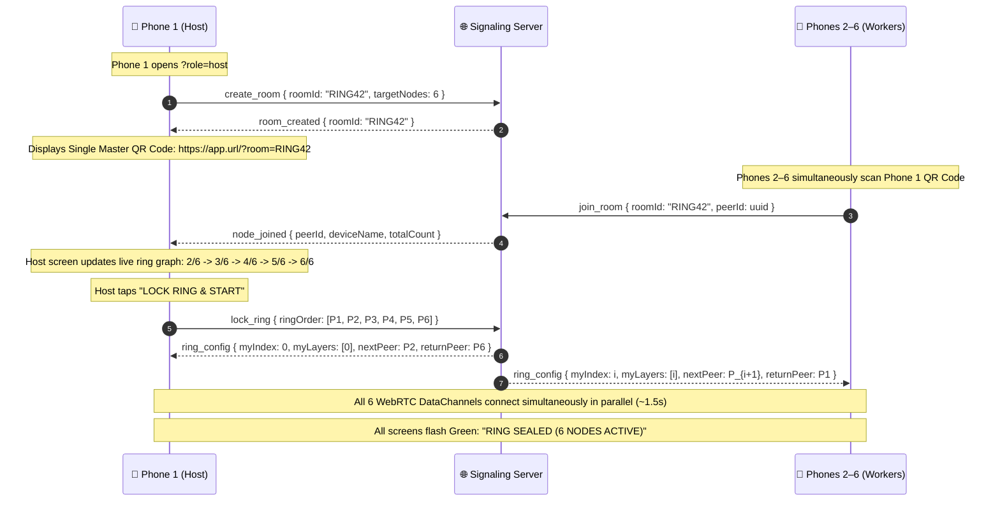

# P2P Mobile Mesh Inference: 6-Phone Ring Topology (Method 1 — Master QR)

> **Architecture:** Dynamic Multi-Device Pipeline Parallelism over a P2P WebRTC Token Ring  
> **Pairing Method:** Method 1 — Single Master QR Code Lobby (Simultaneous 10-Second Setup)  
> **Target Devices:** Up to 6 Stock Consumer Smartphones (iOS Safari / Android Chrome) on Web CPU (JavaScript)  
> **Model:** 6-Layer Byte-Level Micro-Transformer (11,040,768 parameters, PyTorch seed 42)  

---

## 1. Executive Summary & Ring Topology Concept

This implementation plan scales distributed text generation across **up to 6 physical mobile phones** connected over a local peer-to-peer Wi-Fi network using **Method 1 (Single Master QR Code Lobby)**.

The 6-layer Micro-Transformer forward pass is partitioned into a **directional pipeline ring** where each phone executes **exactly 1 Transformer layer** (or balanced subsets if fewer than 6 phones join):

```
                                [Master QR Code]
                                📱 Phone 1 (Host)
                                        │
                    ┌───────────┬───────┴───┬───────────┐
                    ▼           ▼           ▼           ▼
                📱 Phone 2   📱 Phone 3  📱 Phone 4  📱 Phone 5  📱 Phone 6
                (Scanned)   (Scanned)   (Scanned)   (Scanned)   (Scanned)

                                        │
                            [Lock Ring Topology]
                                        ▼

┌────────────────────────────────────────────────────────────────────────────────────────┐
│                                 THE 6-PHONE PIPELINE RING                              │
└────────────────────────────────────────────────────────────────────────────────────────┘

    📱 Phone 1 (Node 0)               📱 Phone 2 (Node 1)               📱 Phone 3 (Node 2)
  ┌─────────────────────┐           ┌─────────────────────┐           ┌─────────────────────┐
  │ • Token Embedding   │   1.5KB   │                     │   1.5KB   │                     │
  │ • Pos. Embedding    │──────────▶│ • Layer 1 Forward   │──────────▶│ • Layer 2 Forward   │
  │ • Layer 0 Forward   │    WebRTC │                     │    WebRTC │                     │
  └─────────────────────┘           └─────────────────────┘           └─────────────────────┘
             ▲                                                                   │
             │                                                                   │ 1.5KB
             │ 1 Byte (Sampled Token)                                            │ WebRTC
             │ Shortcut Feedback Channel                                         ▼
  ┌─────────────────────┐           ┌─────────────────────┐           ┌─────────────────────┐
  │ • Layer 5 Forward   │   1.5KB   │                     │   1.5KB   │                     │
  │ • Final LayerNorm   │◀──────────│ • Layer 4 Forward   │◀──────────│ • Layer 3 Forward   │
  │ • LM Head + Argmax  │    WebRTC │                     │    WebRTC │                     │
  └─────────────────────┘           └─────────────────────┘           └─────────────────────┘
    📱 Phone 6 (Node 5)               📱 Phone 5 (Node 4)               📱 Phone 4 (Node 3)
```

### Why Method 1 (Master QR) is the Winning Architecture:
1. **Zero Friction Onboarding:** Phone 1 displays one Master QR code. Phones 2 through 6 point their cameras at Phone 1 simultaneously. The entire 6-phone mesh pairs in **under 10 seconds**.
2. **Ultra-Low Memory Footprint:** Each phone only loads **$\approx 7.1\text{ MB}$** of weights into RAM (1 single layer), eliminating mobile browser memory exhaustion.
3. **Constant Network Transfer:** During decode, every jump between adjacent phones transfers **strictly 1,536 bytes** ($1 \times 384 \times 4\text{ bytes}$).
4. **Dynamic Adaptability:** If only 2, 3, or 4 phones join, the system automatically redistributes the 6 layers evenly among the connected devices.

---

## 2. Hard Requirements & Prohibitions

| Constraint | Specification & Compliance |
|---|---|
| **Split Execution** | Every participating phone computes only its assigned slice of layers. No single device ever runs the full model. |
| **Local Transport** | All activation tensors ($h_i$) and generated token bytes travel exclusively over direct WebRTC DataChannels over local Wi-Fi. |
| **Zero Centralized Data Relays** | The Node.js signaling server only facilitates initial room joining and SDP/ICE exchange. Zero activation or token bytes pass through any central server or TURN relay. |
| **Zero App Installations** | 100% vanilla web stack (HTML5, ES Modules, WebRTC, Float32Array). Runs natively in stock iOS Safari and Android Chrome. No native wrappers, no APK sideloading, no TestFlight. |
| **Web CPU Only** | Strictly NO WebGPU, NO WebGL shaders, NO WASM SIMD experimental browser flags. All tensor operations run in pure JavaScript on the CPU. |
| **Deterministic Seed 42** | Weights generated with PyTorch `torch.manual_seed(42)`. At `temperature = 0.0`, greedy argmax sampling guarantees identical byte-for-byte deterministic outputs on any device pair. |

---

## 3. Exact Model Architecture & Parameter Accounting

### 3.1 Architectural Hyperparameters
* **Model Class:** Vanilla Causal Decoder Transformer (GPT-2 style, Pre-LN)
* **Vocab Size ($V$):** `256` (Raw ASCII / UTF-8 bytes `[0..255]`; no BPE tokenizer needed)
* **Context Length ($T_{max}$):** `512`
* **Layers ($L$):** `6`
* **Hidden Dimension ($d_{model}$):** `384`
* **Attention Heads ($n_{heads}$):** `6`
* **Head Dimension ($d_{head}$):** $384 / 6 = \mathbf{64}$
* **Feed-Forward Dimension ($d_{ff}$):** $4 \times 384 = \mathbf{1536}$

### 3.2 Exact Parameter Verification (11,040,768 Parameters)
Every linear layer includes additive bias; each Transformer block employs Pre-LayerNorm:

| Layer Component | Dimensions / Formula | Weight Params | Bias Params | Subtotal |
|---|---|---|---|---|
| **Token Embedding** | $256 \times 384$ | $98,304$ | — | $98,304$ |
| **Positional Embedding** | $512 \times 384$ | $196,608$ | — | $196,608$ |
| **Per Layer ($L_i$): LN 1** | $384$ | $384$ | $384$ | $768$ |
| **Per Layer ($L_i$): QKV Proj** | $384 \to 3 \times 384$ ($1152$) | $442,368$ | $1,152$ | $443,520$ |
| **Per Layer ($L_i$): Out Proj** | $384 \to 384$ | $147,456$ | $384$ | $147,840$ |
| **Per Layer ($L_i$): LN 2** | $384$ | $384$ | $384$ | $768$ |
| **Per Layer ($L_i$): FFN Up** | $384 \to 1536$ | $589,824$ | $1,536$ | $591,360$ |
| **Per Layer ($L_i$): FFN Down** | $1536 \to 384$ | $589,824$ | $384$ | $590,208$ |
| **Single Transformer Block** | Sum of above | $1,770,240$ | $4,224$ | **$1,774,464$** |
| **6 Transformer Blocks Total** | $6 \times 1,774,464$ | $10,621,440$ | $25,344$ | **$10,646,784$** |
| **Final LayerNorm** | $384$ | $384$ | $384$ | $768$ |
| **LM Head** (tied to Token Emb) | $384 \to 256$ | $98,304$ | — | $98,304$ |
| **GRAND TOTAL** | | **$11,014,656$** | **$26,112$** | **$\mathbf{11,040,768}$** |

$$\text{Binary Size in FP32} = 11,040,768 \times 4\text{ bytes} = \mathbf{44,163,072\text{ bytes}} \approx \mathbf{42.12\text{ MB}}$$

---

## 4. 6-Phone Layer Allocation & Memory Footprint

When 6 phones form the ring, the model components and memory are allocated as follows:

| Node | Device Role | Components Executed | Active Weight Count | Memory in RAM |
|---|---|---|---|---|
| **Node 0** (Phone 1) | Host / Pipeline Start | Token Emb + Pos Emb + Layer 0 | $2,069,376$ | **$\approx 8.28\text{ MB}$** |
| **Node 1** (Phone 2) | Worker 1 | Layer 1 | $1,774,464$ | **$\approx 7.10\text{ MB}$** |
| **Node 2** (Phone 3) | Worker 2 | Layer 2 | $1,774,464$ | **$\approx 7.10\text{ MB}$** |
| **Node 3** (Phone 4) | Worker 3 | Layer 3 | $1,774,464$ | **$\approx 7.10\text{ MB}$** |
| **Node 4** (Phone 5) | Worker 4 | Layer 4 | $1,774,464$ | **$\approx 7.10\text{ MB}$** |
| **Node 5** (Phone 6) | Worker 5 / Sampler | Layer 5 + Final LN + LM Head | $1,873,536$ | **$\approx 7.49\text{ MB}$** |

### Dynamic Fallback for Any Device Count $N$:
If fewer than 6 phones join (e.g., $N=2, 3, 4$), the host distributes the 6 layers using a balanced allocation formula:
$$\text{base} = \lfloor 6 / N \rfloor, \quad \text{remainder} = 6 \pmod N$$
* **$N = 2$ phones:** Node 0 runs Layers 0–2; Node 1 runs Layers 3–5 + LM Head.
* **$N = 3$ phones:** Node 0 runs Layers 0–1; Node 1 runs Layers 2–3; Node 2 runs Layers 4–5 + LM Head.
* **$N = 4$ phones:** Node 0 runs Layers 0–1; Node 1 runs Layers 2–3; Node 2 runs Layer 4; Node 3 runs Layer 5 + LM Head.

---

## 5. Method 1 (Master QR) User Experience & Discovery Flow



### The WebRTC Channel Structure for Node $i$:
Each phone maintains strictly **two** lightweight DataChannels:
1. **Downstream Channel (`next_node`):** Node $i$ connects to Node $(i+1) \pmod 6$ to transmit intermediate activations $h_i$.
2. **Token Return Channel (`token_return`):** A direct shortcut between Node 5 (Phone 6) and Node 0 (Phone 1) to transmit the sampled 1-byte token without routing it backwards through intermediate nodes.

---

## 6. Forward Pass Mechanics & Partitioned KV-Cache

### 6.1 Prefill Phase (Prompt Ingestion)
1. **Node 0 (Phone 1):** Takes prompt bytes $b_0 \dots b_{P-1}$. Embeds all $P$ tokens and runs Layer 0. Caches $K_0, V_0$ for positions $0 \dots P-1$. Sends activation tensor $h_0$ (`Float32Array[P, 384]`) to Node 1.
2. **Node 1 (Phone 2):** Receives $[P, 384]$. Runs Layer 1. Caches $K_1, V_1$. Sends $h_1$ to Node 2.
3. **Nodes 2, 3, 4:** Repeat the forward computation for their respective layers and forward downstream.
4. **Node 5 (Phone 6):** Runs Layer 5. Caches $K_5, V_5$. Takes the vector at the final position $h_5[P-1]$, applies Final LayerNorm + LM Head to produce `logits[256]`.
5. **Node 5:** Samples byte $t_P$ via greedy argmax. Emits $t_P$ across the direct token shortcut channel back to Node 0.

### 6.2 Decode Phase (Autoregressive Generation Loop)
For every generated byte token:

$$\text{Node 0} \xrightarrow{h_0\text{ (1.5 KB)}} \text{Node 1} \xrightarrow{h_1\text{ (1.5 KB)}} \dots \xrightarrow{h_4\text{ (1.5 KB)}} \text{Node 5} \xrightarrow{\text{Token (1 B)}} \text{Node 0}$$

```
Step t:
  1. Node 0 embeds the single previous token byte at sequence position startPos.
  2. Node 0 computes Layer 0 self-attention (new Query attends over cached K₀, V₀).
  3. Node 0 sends h₀: Float32Array[1, 384] (1,536 bytes) to Node 1.
  4. Node 1 receives 1,536 bytes, computes Layer 1, sends h₁ (1,536 bytes) to Node 2.
  5. Node 2 receives 1,536 bytes, computes Layer 2, sends h₂ (1,536 bytes) to Node 3.
  6. Node 3 receives 1,536 bytes, computes Layer 3, sends h₃ (1,536 bytes) to Node 4.
  7. Node 4 receives 1,536 bytes, computes Layer 4, sends h₄ (1,536 bytes) to Node 5.
  8. Node 5 receives 1,536 bytes, computes Layer 5 + Final LN + LM Head -> logits[256].
  9. Node 5 samples argmax byte token.
  10. Node 5 sends 1 byte directly back to Node 0.
  11. Node 0 updates display, appends byte to context, and triggers step t+1.
```

**Network Payload Analysis:**
* Every pipeline jump is strictly **$1,536\text{ bytes}$**.
* Over a 5 GHz local Wi-Fi router, latency per 1.5 KB UDP packet is $\approx 1.5\text{–}3\text{ ms}$.
* 5 inter-node hops $\times 2.5\text{ ms} \approx 12.5\text{ ms}$ total network transit time per token.
* Combined with parallelized single-layer compute ($\approx 3\text{ ms}$ per phone), the 6-phone ring achieves **$25\text{–}40\text{ tokens/sec}$**.

---

## 7. Team Division: 2 Members Implementing the 6-Phone Ring

The project tasks are partitioned between the two members based on the Ring topology:

```
┌────────────────────────────────────────────────────────────────────────┐
│               MEMBER 1: NETWORK, ORCHESTRATION & HOST UI               │
├────────────────────────────────┬───────────────────────────────────────┤
│ Responsibilities:              │ Deliverables:                         │
│ • WebSocket Multi-Client Lobby │ 1. server/server.js                   │
│ • Ring P2P Topology Manager    │ 2. client/network/signaling.js        │
│ • Host Ring Orchestrator       │ 3. client/network/p2p-ring.js         │
│ • Single Master QR UI          │ 4. client/core/host-orchestrator.js   │
│ • Animated Ring Visualizer     │ 5. client/ui/host-ui.js               │
│ • End-to-end Telemetry         │ 6. client/index.html & style.css      │
└────────────────────────────────┴───────────────────────────────────────┘

┌────────────────────────────────────────────────────────────────────────┐
│             MEMBER 2: ML, INFERENCE ENGINE & PIPELINE WORKER           │
├────────────────────────────────┬───────────────────────────────────────┤
│ Responsibilities:              │ Deliverables:                         │
│ • PyTorch Seed-42 Weight Gen   │ 1. tools/generate_weights.py          │
│ • Sliced Layer Weight Loader   │ 2. tools/verify_weights.py            │
│ • Pure CPU Math Engine         │ 3. client/core/weights.js             │
│ • Single-Layer KV-Cache System │ 4. client/core/transformer.js         │
│ • Generic Node Pipeline Worker │ 5. client/core/node-worker.js         │
│ • Worker UI & Mirror Stream    │ 6. client/ui/worker-ui.js             │
└────────────────────────────────┴───────────────────────────────────────┘
```

---

## 8. Exact Interface Contracts Between Member 1 & Member 2

### Interface 1: Ring Configuration Protocol (`client/network/p2p-ring.js`)
*Produced by Member 1 $\to$ Delivered to Member 2's `node-worker.js`*
```typescript
interface RingConfig {
  nodeIndex: number;         // 0 to N-1
  totalNodes: number;        // e.g. 6
  assignedLayers: number[];  // e.g. [0] for Node 0, [2] for Node 2, [3,4] if N=4
  isHost: boolean;           // true if Node 0
  isSampler: boolean;        // true if final node (Node N-1)
}

class RingP2PManager {
  constructor(signaling: SignalingClient, config: RingConfig);
  initiateConnections(): Promise<void>; // Establishes WebRTC with next node & host
  
  // Downstream activation transport:
  sendActivation(data: Float32Array): void;
  onActivation(callback: (data: Float32Array) => void): void;
  
  // Shortcut token feedback transport:
  sendTokenToHost(token: number): void;
  onTokenFromSampler(callback: (token: number) => void): void;
  
  get isRingSealed(): boolean;
}
```

### Interface 2: Modular Sliced Weight Loader (`client/core/weights.js`)
*Produced by Member 2 $\to$ Consumed by `node-worker.js`*
```typescript
interface SingleLayerWeights {
  ln1w: Float32Array;  // [384]
  ln1b: Float32Array;  // [384]
  qkvW: Float32Array;  // [1152, 384]
  qkvB: Float32Array;  // [1152]
  oW:   Float32Array;  // [384, 384]
  oB:   Float32Array;  // [384]
  ln2w: Float32Array;  // [384]
  ln2b: Float32Array;  // [384]
  ffW1: Float32Array;  // [1536, 384]
  ffB1: Float32Array;  // [1536]
  ffW2: Float32Array;  // [384, 1536]
  ffB2: Float32Array;  // [384]
}

interface NodeWeights {
  tokenEmb?: Float32Array;        // Only present on Node 0 [256, 384]
  posEmb?:   Float32Array;        // Only present on Node 0 [512, 384]
  layers:    SingleLayerWeights[]; // The 1 (or more) assigned layer(s)
  finalLnW?: Float32Array;        // Only present on final Sampler Node [384]
  finalLnB?: Float32Array;        // Only present on final Sampler Node [384]
  lmHeadW?:  Float32Array;        // Only present on final Sampler Node [256, 384]
}

// Loads weights.bin and slices out ONLY the tensors needed for assignedLayers:
function loadNodeWeights(
  assignedLayers: number[], 
  isHost: boolean, 
  isSampler: boolean,
  onProgress?: (pct: number) => void
): Promise<NodeWeights>;
```

### Interface 3: Pure CPU Transformer Engine (`client/core/transformer.js`)
*Produced by Member 2 $\to$ Consumed by `node-worker.js`*
```typescript
class TransformerNodeBlock {
  constructor(weights: NodeWeights, isHost: boolean, isSampler: boolean);
  
  // Forward pass through assigned layers:
  // Node 0: takes tokenIds -> outputs h_out
  // Node 1..N-2: takes h_in -> outputs h_out
  // Node N-1: takes h_in -> outputs { token: number, logits: Float32Array }
  forward(
    input: Uint8Array | Float32Array, 
    startPos: number, 
    temperature?: number
  ): Float32Array | { token: number; logits: Float32Array };

  reset(): void; // Clears the single-layer KV-cache
  get sequenceLength(): number;
}
```

---

## 9. Step-by-Step Implementation Roadmap

```
PHASE 1: Deterministic Weights & Multi-Client Signaling Lobby
  ├─ Member 2: Generate & verify weights.bin with PyTorch seed 42
  └─ Member 1: Build Node.js WebSocket signaling lobby for up to 6 peers

PHASE 2: Ring P2P Transport & Pure CPU Math Engine
  ├─ Member 2: Build weights.js (sliced loading) & transformer.js (tiled matmul)
  └─ Member 1: Build p2p-ring.js (circular connection orchestration)

PHASE 3: Generic Pipeline Node Worker & Host Orchestrator
  ├─ Member 2: Build node-worker.js (universal pipeline stage)
  └─ Member 1: Build host-orchestrator.js (autoregressive prefill/decode loop)

PHASE 4: Master QR UI & Live Animated Ring Display
  ├─ Member 2: Build worker-ui.js (layer badge, token stream mirror)
  └─ Member 1: Build host-ui.js (Master QR generator, ring status canvas)

PHASE 5: 6-Phone End-to-End Benchmark & Polish
  └─ Both: Pair 6 phones over local Wi-Fi, benchmark TPS, verify determinism
```

### Phase 1: Deterministic Weights & Multi-Client Signaling Lobby
* **Member 2 Task:**
  1. Write `tools/generate_weights.py` using PyTorch with `torch.manual_seed(42)`.
  2. Sequentially serialize all 19 parameter groups as raw FP32 little-endian bytes to `weights.bin`.
  3. Tie `lm_head.weight` to `token_emb.weight`.
  4. Write `tools/verify_weights.py` to assert the byte length is exactly `44,163,072` bytes.
* **Member 1 Task:**
  1. Write `server/package.json` and `server/server.js`.
  2. Implement room lobby: Phone 1 sends `{ type: 'create_room', room: 'MESH42' }`.
  3. Allow up to 6 clients to join room `MESH42`.
  4. When host sends `{ type: 'lock_ring' }`, the server assigns circular indices $0 \dots N-1$ and relays SDP/ICE messages between adjacent neighbor pairs: $(0 \leftrightarrow 1)$, $(1 \leftrightarrow 2)$, $(2 \leftrightarrow 3)$, $(3 \leftrightarrow 4)$, $(4 \leftrightarrow 5)$, and token return channel $(5 \leftrightarrow 0)$.

### Phase 2: Ring P2P Transport & Pure CPU Math Engine
* **Member 2 Task:**
  1. Implement `client/core/weights.js`: Slices `weights.bin` in memory so Node $i$ only allocates typed views for its assigned layer(s).
  2. Implement `client/core/transformer.js`:
     - 32×32 tiled `matmul` and `linearForward`.
     - Standard `layerNorm` ($\epsilon = 10^{-5}$).
     - Horner's approximation `gelu`.
     - Multi-head causal self-attention with independent KV-cache (`[512, 384]`).
* **Member 1 Task:**
  1. Implement `client/network/signaling.js`: Client WebSocket handling room join and neighbor discovery.
  2. Implement `client/network/p2p-ring.js`:
     - Instantiates downstream `RTCPeerConnection` to neighbor $i+1$.
     - Instantiates token shortcut `RTCPeerConnection` between Node $N-1$ and Node 0.
     - Implements binary framing: `0x01` activation buffer, `0x02` single uint8 byte.

### Phase 3: Generic Pipeline Node Worker & Host Orchestrator
* **Member 2 Task (`node-worker.js`):**
  1. Create universal `NodeWorker` class running on all worker devices (Nodes 1 through $N-1$).
  2. Listen on upstream DataChannel: receives $h_{in}$ (`Float32Array`).
  3. Compute assigned layer forward pass:
     - Intermediate nodes (Nodes 1 to $N-2$): forward $h_{out}$ to downstream neighbor.
     - Final node (Node $N-1$): compute Layer 5 + Final LN + LM Head $\to$ argmax sample token byte $\to$ emit across shortcut channel to Node 0.
* **Member 1 Task (`host-orchestrator.js`):**
  1. Create `HostOrchestrator` on Node 0 (Phone 1).
  2. Implement autoregressive loop:
     - **Prefill:** Embed prompt $\to$ Layer 0 forward $\to$ transmit $h_0$ $[P, 384]$ downstream.
     - **Decode Loop:** Await 1-byte token from final node $\to$ render character $\to$ embed single token $\to$ transmit $h_0$ $[1, 384]$ downstream.

### Phase 4: Master QR UI & Live Animated Ring Display
* **Member 1 Task (`host-ui.js` & `index.html`):**
  1. On Phone 1, display a large **Master QR code** encoding: `https://<tunnel-url>/?room=RING42`.
  2. Render an interactive HTML5 Canvas / SVG ring visualizer showing all connected nodes in a circle.
  3. Add "Form Ring & Lock" button, prompt textarea, temperature slider, and generation controls.
  4. Stream decoded characters in real time as tokens arrive.
  5. Display benchmark HUD: **Tokens/sec (TPS)**, **Ring Cycle RTT**, **Per-Hop Latency**.
* **Member 2 Task (`worker-ui.js`):**
  1. On Worker phones (Phones 2–6), render a minimal, clean dashboard:
     - Node Badge: *"Node 3 of 6 — Computing Layer 2"*.
     - Glowing pulse animation that flashes whenever an activation passes through the device.
     - Real-time token mirror stream showing generated text synchronously with the host.
     - Worker CPU execution time counter (ms).

### Phase 5: 6-Phone End-to-End Benchmark & Polish
* Both members test the system across 6 physical smartphones over local Wi-Fi.
* Verify determinism: With `temperature = 0.0`, all implementations output the exact same deterministic byte sequence.

---

## 10. Expected Directory Layout

```
Transformer/
├── IMPLEMENTATION_PLAN.md      # This master document
├── README.md                   # Quickstart & architecture overview
├── weights.bin                 # Seed-42 FP32 binary weights (44,163,072 bytes)
│
├── server/
│   ├── package.json            # Express + ws dependencies
│   └── server.js               # Multi-peer lobby signaling relay & static host
│
├── client/
│   ├── index.html              # Universal entry (handles Host lobby vs Worker node)
│   ├── style.css               # Responsive dark theme with ring canvas animation
│   │
│   ├── core/
│   │   ├── weights.js          # Sliced Float32Array weight loader per node
│   │   ├── transformer.js      # Pure CPU math engine (tiled matmul, attention, KV-cache)
│   │   ├── host-orchestrator.js# Phone 1 autoregressive pipeline driver
│   │   └── node-worker.js      # Universal pipeline stage worker (Nodes 1 to N-1)
│   │
│   ├── network/
│   │   ├── signaling.js        # Multi-client WebSocket signaling client
│   │   └── p2p-ring.js         # Circular WebRTC DataChannel ring manager
│   │
│   └── ui/
│       ├── host-ui.js          # Master QR generator, ring canvas visualizer, prompt input
│       └── worker-ui.js        # Worker status badge, ring pulse animator, token mirror
│
└── tools/
    ├── generate_weights.py     # Deterministic PyTorch seed-42 weights generator
    └── verify_weights.py       # Mathematical sanity & parameter count validator
```

---

## 11. Complete 6-Phone Execution & Benchmark Routine

### Step 1: Export & Validate Deterministic Weights
```bash
cd tools
python generate_weights.py
python verify_weights.py
```
*Verification criteria:* Total parameter count must equal `11,040,768`; file size must equal `44,163,072` bytes.

### Step 2: Start the Signaling Server
```bash
cd ../server
npm install
node server.js
```

### Step 3: Expose via HTTPS Tunnel (Required for WebRTC)
```bash
npx ngrok http 3000
```
Copy the secure HTTPS URL: `https://<subdomain>.ngrok-free.app`.

### Step 4: The 10-Second 6-Phone Pairing Routine
1. **Phone 1 (Host):** Open `https://<subdomain>.ngrok-free.app/?role=host`.
2. Phone 1 displays the **Single Master QR Code**.
3. **Phones 2, 3, 4, 5, 6:** Open their native camera apps and point them at Phone 1's screen.
4. All 5 worker phones automatically join the lobby.
5. Phone 1's screen shows the circular ring fill up: `(1/6) -> (2/6) -> (3/6) -> (4/6) -> (5/6) -> (6/6)`.
6. Phone 1 taps **"Seal Ring"**.
7. All 6 WebRTC DataChannels lock in under 1.5 seconds.

### Step 5: Benchmark Text Generation Across 6 Phones
1. Input prompt on Phone 1 (e.g., `"The future of artificial intelligence is"`).
2. Set `temperature = 0.0`.
3. Tap **Generate Text**.
4. Observe the pulse wave travel visually around the circle of phones on the table as each byte is generated collaboratively across all 6 devices.

---

## 12. Benchmark Metrics Checklist for Judges

| Metric | Target | Measurement Method |
|---|---|---|
| **P2P Split Verification** | 100% Compliant | Console logs confirm each phone computes strictly its assigned layer(s). |
| **Throughput (Tokens/sec)** | `> 25–40 TPS` | $\text{Generated Tokens} / \text{Elapsed Seconds}$ |
| **Per-Node Compute Time** | `~3–6 ms` | `performance.now()` delta per individual layer on each phone |
| **Ring Cycle Transit Time** | `~12–18 ms` | Full round-trip time across all 6 local Wi-Fi hops |
| **RAM Footprint per Phone** | `< 10 MB` | Verified via browser performance memory profiling |
| **Zero Cloud Compute** | 100% On-Device | Disconnect WAN on router after initial load; 6-phone ring generates text completely offline. |
| **Determinism** | 100% Identical | Same prompt at `temp = 0.0` yields identical byte output on any set of 6 phones. |
